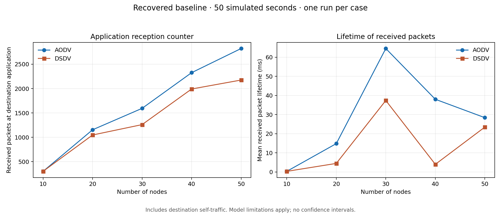

# Wireless Mesh Routing: AODV vs. DSDV

An OMNeT++/INET simulation project exploring routing behavior as a stationary wireless mesh network grows from 10 to 50 nodes.

This repository packages Abdullah Ababneh's recovered graduation-project configuration, a command-line runner, result analysis, and a newly generated reference dataset. It is associated with the research publication **Comparative Scalability Analysis of AODV and DSDV Routing in Dense Wireless Mesh Networks**.

## Reports and thesis

- **[Read the original thesis — public PDF](thesis/Thesis.pdf)**
- **[Editable Overleaf/LaTeX source](thesis/source)** · **[Download the public source ZIP](thesis/Overleaf-source.zip)**
- **[New project report and execution check](docs/PROJECT_REPORT.md)**
- [All documentation](docs) · [Thesis edition notes](thesis/README.md)

The thesis is a historical research document. Its public edition omits administrative pages and the student identifier. The later project report and methodology audit describe the recovered baseline separately; their findings should not be confused with validation of every thesis conclusion.



## What is included

- A network model and separate AODV and DSDV configurations.
- A portable runner that loads an existing OMNeT++/INET installation.
- Analysis of scalar measurements, plus plots and a compact reference dataset.
- Setup instructions, a methodology audit, and publication information.
- Automated checks for the documentation/data pipeline.

Start with the [project report](docs/PROJECT_REPORT.md), [setup guide](docs/SETUP.md), or [GitHub publishing guide](docs/GITHUB_SETUP.md).

**Execution status:** both protocols completed all five network sizes, with 50 simulated seconds per case, on the local installation. These checks establish that the recovered baseline runs. They do not validate all conclusions of the published paper.

## Quick start

Prerequisites: Bash, Python 3.10+, a compiled OMNeT++ installation, and a compiled INET library. The local installation used for verification reports OMNeT++ 6.3.0 and INET 4.5.4. Compatibility with a fresh upstream installation has not yet been established; see the [setup guide](docs/SETUP.md).

```bash
python3 -m venv .venv
source .venv/bin/activate
python -m pip install -r requirements.txt

# Set these to your own existing installations.
export OMNETPP_ROOT=/path/to/omnetpp
export INET_ROOT=/path/to/inet

# One complete case per protocol; generated data stays under results/raw/.
bash scripts/run.sh AODV_Test 0
bash scripts/run.sh DSDV_Test 0

# Or run all five cases for each protocol.
bash scripts/run.sh all
python scripts/analyze.py --input results/raw --output results/generated
python scripts/plot_results.py --input results/generated/summary.json --output figures/generated
```

To inspect the included reference data without installing the simulator:

```bash
python scripts/check_reference.py
python scripts/plot_results.py --input results/reference/summary.json --output figures/generated
```

The analysis script itself uses only Python's standard library. Matplotlib is required only for plotting.

## Baseline configuration

| Setting | Recovered baseline |
| --- | --- |
| Protocols | AODV and DSDV |
| Nodes | 10, 20, 30, 40, 50 |
| Duration | 50 simulated seconds |
| Area | Configured as 1,000 × 1,000 m |
| Movement | Stationary; configured speed is zero |
| Application | 1,000-byte UDP messages; random send interval of 0.5–1 s |
| Destination | `host[0]` |
| Repetitions | One per protocol and node count |
| Recorded range setting | 100 m; its physical effect is not established |

## Important interpretation details

The baseline is preserved for traceability. Its recorded parameters show that `host[0]` runs `UdpBasicApp`, although a later configuration rule attempts to select `UdpSink`. Consequently, the destination also sends traffic, including local traffic. The instantiated medium is the generic `RadioMedium`, despite a configuration entry naming `Ieee80211ScalarRadioMedium`. The ideal energy-storage model is not a realistic finite battery.

The plots show **destination application counters** and **mean received packet lifetime** from this baseline. They are not presented as uncontaminated wireless delivery ratios, finite-battery lifetime, or evidence of statistical superiority. Read the [methodology audit](docs/METHODOLOGY.md) before interpreting them.

## Reference results and provenance

The included reference summary was freshly generated from the current configuration. Raw simulator output is intentionally excluded from Git because the ten verified runs produced approximately 4.4 GB of data. The JSON summary records hashes of the scalar inputs, their measured counters, and selected effective parameters.

The recovered archive contains mixed settings, three missing scalar summaries, and a ten-node DSDV trace ending near 27.1 simulated seconds. It is **not** mixed into the new reference dataset. See [validation notes](docs/VALIDATION.md).

## Publication

**Comparative Scalability Analysis of AODV and DSDV Routing in Dense Wireless Mesh Networks** — Ala Khalifeh, Abdullah Ababneh, and Iacovos Ioannou; listed for the 2026 IEEE Jordan Conference on Applied Electrical Engineering and Computing Technologies (AEECT).

- [Publication record on ResearchGate](https://www.researchgate.net/publication/413627726_Comparative_Scalability_Analysis_of_AODV_and_DSDV_Routing_in_Dense_Wireless_Mesh_Networks)
- [DOI listed in that record](https://doi.org/10.1109/AEECT69724.2026.11657843)
- [Citation metadata](CITATION.cff)

Publication metadata is transcribed from the supplied ResearchGate record. This repository's reference results are a later execution check, not a claim to reproduce every published figure. The publication PDF and private Overleaf sharing link are not distributed here.

## Project layout

```text
simulations/        Network definition and original configuration
scripts/            Run, summarize, plot, and check reference data
results/reference/  Compact verified baseline summary
figures/            Generated comparison figures
thesis/             Public thesis PDF, editable source, and source ZIP
docs/               Setup, validation, methodology, and GitHub guide
.github/workflows/  Checks that do not require the simulator
requirements.txt    Python plotting dependency
CITATION.cff        Citation information
```

The project reuses INET's existing models; it does not implement AODV or DSDV from scratch. No simulator binaries or INET sources are bundled. See [NOTICE.md](NOTICE.md) for attribution and license status.
